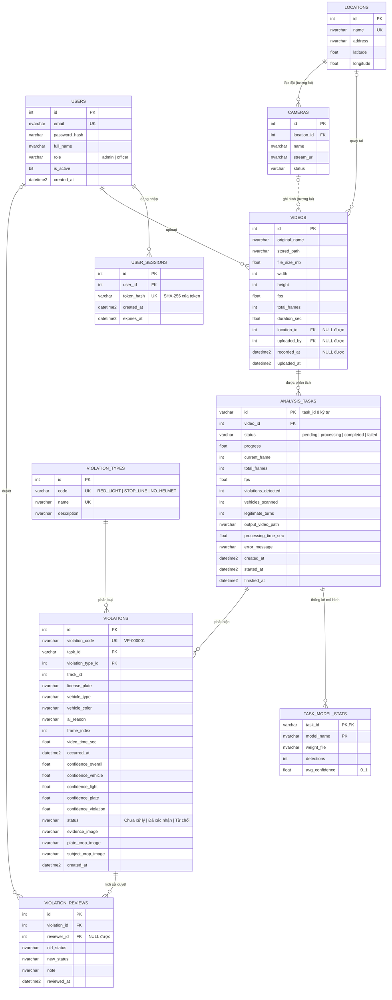

# Traffic AI – Thiết kế Cơ sở dữ liệu

Chưa có dữ liệu camera, nên **nguồn dữ liệu là video được upload** (`videos`). Bảng `cameras` được để sẵn chỗ cho sau này (nét đứt trong sơ đồ): khi có camera chỉ cần tạo bảng `cameras` và thêm cột `videos.camera_id` (cho phép NULL), các bảng khác giữ nguyên.

## Sơ đồ ERD

## Giải thích quan hệ

| Quan hệ | Kiểu | Ý nghĩa |
|---|---|---|
| `users` – `user_sessions` | 1 – n | Một tài khoản đăng nhập trên nhiều thiết bị; đăng xuất thì xóa phiên |
| `users` – `videos` | 1 – n | Một cán bộ upload nhiều video |
| `locations` – `videos` | 1 – n | Nhiều video quay tại cùng một địa điểm |
| `videos` – `analysis_tasks` | 1 – n | Một video có thể phân tích nhiều lần (ví dụ khi đổi tham số hoặc mô hình) |
| `analysis_tasks` – `task_model_stats` | 1 – n | Mỗi lần phân tích lưu số liệu của 6 mô hình AI |
| `analysis_tasks` – `violations` | 1 – n | Mỗi lần phân tích phát hiện nhiều vi phạm |
| `violation_types` – `violations` | 1 – n | Danh mục chuẩn hóa loại vi phạm |
| `violations` – `violation_reviews` | 1 – n | Mỗi lần đổi trạng thái hồ sơ được ghi lại |
| `users` – `violation_reviews` | 1 – n | Cán bộ nào đã duyệt |

## Quy tắc thiết kế

- **Không lưu dữ liệu tính được:** giờ, ngày và mốc video hiển thị (`time_str`, `date_str`, `video_time`) được tính từ `occurred_at` và `video_time_sec` khi trả API.
- **Thời điểm vi phạm:** `occurred_at = videos.recorded_at + video_time_sec`. Nếu không biết thời điểm quay thì dùng `uploaded_at`.
- **Độ tin cậy NULL được:** cột để NULL khi mô hình không cung cấp điểm, thay vì điền số giả.
- **Toàn vẹn dữ liệu:** `status` và `role` có ràng buộc `CHECK`, các khóa ngoại đều được khai báo.
- **Không mất dữ liệu cũ:** bảng cấu trúc cũ được đổi tên thành `*_legacy`. `server.py` chuyển dữ liệu sang bảng mới khi khởi động.

## Vẽ ERD

- **VS Code:** cài extension *Markdown Preview Mermaid Support* rồi mở file này ở chế độ Preview.
- **SSMS:** chọn `traffic_ai_db` → *Database Diagrams* → *New Database Diagram* → chọn 9 bảng. SSMS tự vẽ quan hệ từ các khóa ngoại.
- **Online:** dán khối mermaid ở trên vào https://mermaid.live để xuất PNG/SVG.
